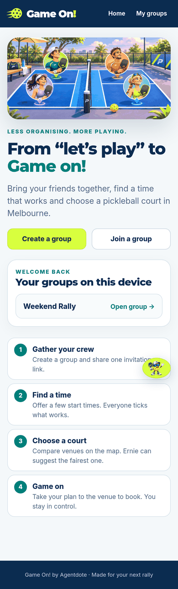
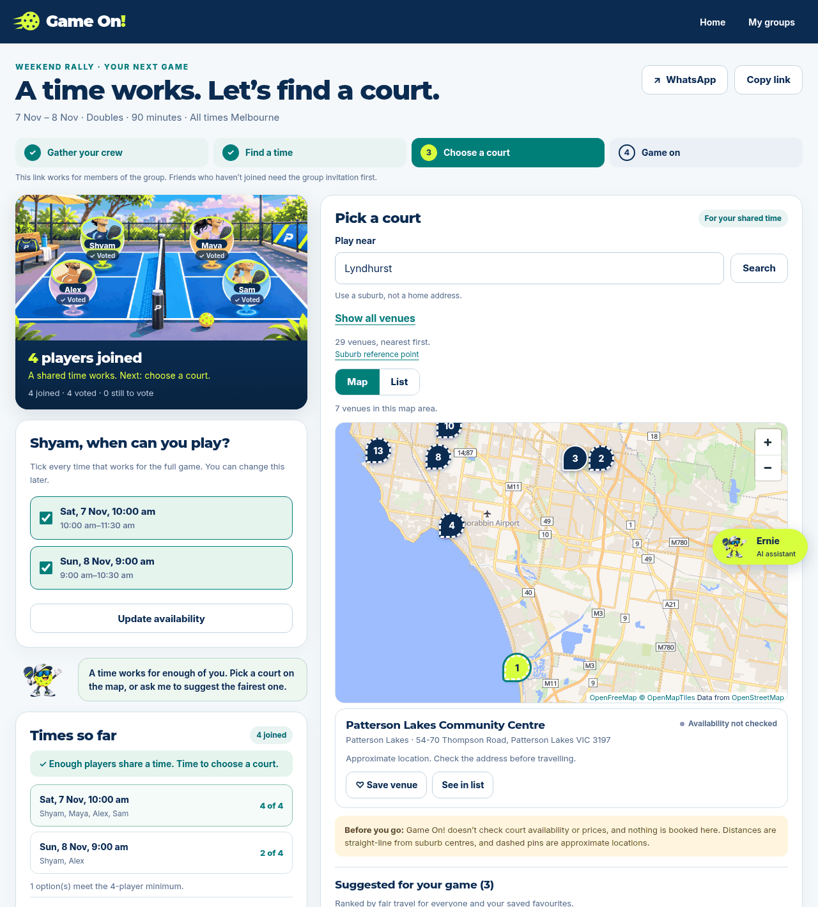
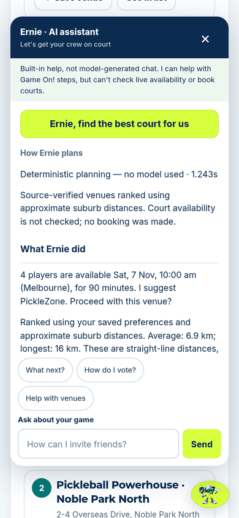
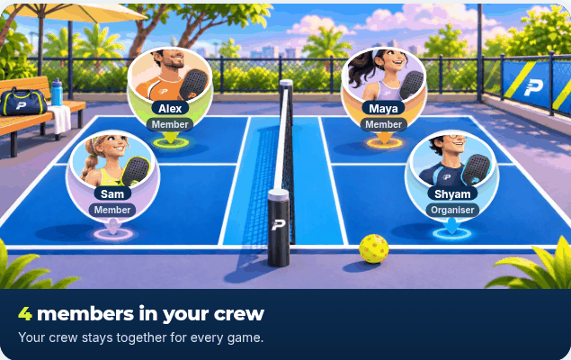

# Game On! 🏓 Live

**Less group-chat chaos. More time on court.**

Game On! is a small pickleball organiser for Melbourne friend groups. An organiser proposes a few times and shares one link. Friends join with a first name and suburb and vote for every slot that works. Once enough people overlap, **Ernie**, the app's agent, finds the fairest court for the group and prepares a booking brief, and a human approves before anything is booked.

Built for Week 3 of *Mastering Agentic AI* (Maven, The Gen Academy) by Shyam Srinivas, as an Agentdote prototype.

| Home | Pick a court | Ernie's proposal | Live court |
| --- | --- | --- | --- |
|  |  |  |  |

More screens (390 px phone and 1280 px desktop) live in [`docs/screenshots/`](docs/screenshots/): `home-*`, `group-*`, `join-*`, `start-game-*`, `game-workspace-*`, `game-waiting-*` and `game-handoff-*`. The UI follows the "Balanced Companion" concept: compact crew and availability on the left, a wide court map on the right, and Ernie on hand when needed.

## The problem

Organising a game of doubles over WhatsApp takes dozens of messages: who's free, when, where, who books, how much. Game On! turns that into one link and one decision.

## How it works

1. **Create a group, then a game:** the organiser creates a reusable group (no account needed), then starts a game with 2 to 6 start times (60, 90 or 120 minutes, Melbourne time). Games are started from inside a group; older standalone game links still open.
2. **Share:** one link goes to the group chat. Reusable groups keep the same crew and favourite venues.
3. **Vote:** friends tick every slot that works. The page updates live, and a game is *ready* once everyone has voted and at least four players share a time.
4. **Ernie, find us a court:** Ernie plans over the real game data and a verified directory of 29 Victorian pickleball venues, then proposes the venue that is fairest on travel for the group.
5. **Approve and book:** the organiser approves, compares alternatives, or says not now. Approval produces a booking brief for the venue's site or a personal AI assistant. Nothing is reserved or paid automatically.

## Ernie: the agent

Ernie is a bounded **LangGraph** decide → act → observe loop.

```text
Organiser: "Ernie, find the best court for us"
        │
        ▼
 Frozen game snapshot (no names, no credentials)
        │
        ▼
 ┌──────────── LangGraph loop (max 6 decisions, 20 s deadline) ────────────┐
 │  decide ──► tool ──► observe ──► decide …                               │
 │  tools: read_game · schedule_game · search_pickleball_venues · rank_venues│
 └──────────────────────────────────────────────────────────────────────────┘
        │
        ▼
 Grounded proposal: players · time · duration · venue · distance
        │
        ▼
 Human choice: Approve / Compare alternatives / Not now
        │
        ▼
 Server revalidates (signed 10-minute receipt, current votes) ──► booking brief
```

Design choices:

- **Tools are real, decisions are bounded.** The model can only choose among permitted, fully bound actions. Scheduling, search and ranking are deterministic Python, so a model cannot invent a venue, time or availability claim.
- **Two modes.** The web app runs a deterministic policy by default. An OpenAI-compatible provider adapter plugs into the same graph, and a live evaluation batch (9 calls, about US$0.02) was compared against the deterministic choices.
- **Human in the loop.** Approval means "approved to enquire", never "booked". Any vote change invalidates the proposal.
- **Privacy.** Players share a suburb, never an address. Booking briefs carry no names, links or credentials.

## Venue directory

29 source-verified pickleball venues across Greater Melbourne and regional Victoria (`gameon/venues/data/melbourne.json`), each with sources, a checked date and an honest location precision (venue pin vs suburb reference). Venues are ranked by geographic fairness: the average and longest straight-line distance across players.

## Tech stack

- **Backend:** Python 3.13, FastAPI, SQLite locally or Neon PostgreSQL hosted, deployed on Vercel (Sydney).
- **Frontend:** vanilla HTML, CSS and JavaScript. No build step.
- **Map:** MapLibre GL with keyless OpenFreeMap tiles.
- **Agent:** LangGraph and Pydantic (optional `requirements-agent.txt`).
- **Tests:** 206 unit and API tests (PostgreSQL tests skip without a test database).

## Run it locally

```bash
python -m pip install -r requirements.txt
python app.py            # http://localhost:8000
```

Tests:

```bash
python -m pip install -r requirements-dev.txt -r requirements-agent.txt
python -m unittest discover -s tests
```

## What's next

- **Court prices:** "From $X/hr" with a checked date for each venue.
- **Live availability:** 11 of the 15 bookable venues use Playbypoint, so one authorised read-only integration covers most of them, labelled *Not checked / Available / Full*.
- **Send to Hark:** hand the booking brief to a personal AI assistant that checks live slots and price, then books after the organiser approves.
- **Player map:** avatars at approximate suburb level for the group view.

## Limits, honestly

Availability and prices are not checked yet, and no court is ever booked by the app. Distances are straight-line between suburb reference points, not travel times. Player identity is a browser-stored credential, suitable for a prototype rather than production.

---

Game On! by Agentdote · Made for your next rally
