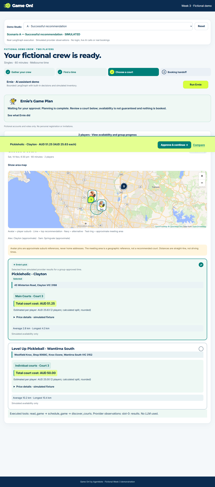
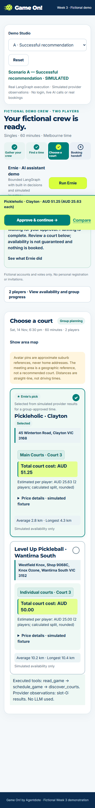
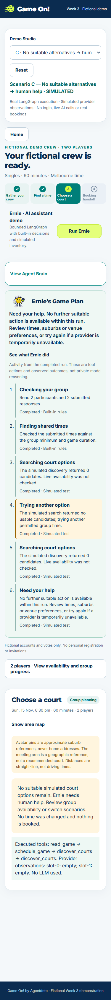

# Game On! — Week 3 agentic planning demo

**Less group-chat chaos. More time on court.** A self-contained, fictional demonstration of a bounded LangGraph agent helping a Melbourne pickleball group choose a court and reach a human-controlled booking handoff.

**Open the public demo: https://game-on-w3-demo.vercel.app**

Verified without login on 6 November 2026 (Australia/Sydney). Separate Vercel project `game-on-w3-demo`; no application environment variables or database connection.

## Try the demo

No account, database setup or API key is required.

1. Select a scenario in **Demo Studio** and click **Run Ernie**.
2. Open **See what Ernie did** to inspect the completed execution record.
3. Compare the court cards/map, then **Approve & continue** to the fictional handoff.
4. Copy a privacy-safe brief to a personal assistant or download a tentative calendar event.
5. Switch scenarios or **Reset** to start over. Each visitor's browser state is independent.

| Scenario | Simulated provider response | Actual graph behaviour |
|---|---|---|
| A — Successful recommendation | Courts found for the first agreed time | Reads group, calculates shared times, calls discovery, returns recommendation |
| B — Unavailable court → replan | First agreed time returns empty; second returns a court | Observes the empty result, makes another decision and executes a second discovery call for the other already-approved time |
| C — Human assistance required | Both permitted searches return empty | Exhausts bounded alternatives and asks for human help; no approval is offered |

Alex and Sam are fictional people who approved both displayed times. B does **not** silently invent a new time. Scenario dates roll forward to future Melbourne evenings so the scheduler's expiry safeguards remain active.

## What is genuinely agentic?

This runs the actual LangGraph **decide → tool → observe → decide** loop, with the existing validated tool contracts, policy gate, maximum six decisions, maximum two discovery attempts, five-second tool limit and twenty-second run deadline. A killable worker enforces the deadline. The visible timeline is projected from completed trace events and validated observations, not a timer or prerecorded animation.

The decision provider is deterministic. There are **no LLM calls**, paid or otherwise. Inventory and prices are explicit simulated fixtures. The second tool call in B is an actual execution chosen after observing failure; changing the fixture response changes the graph outcome. This is a controlled agent-workflow demonstration, not proof of live AI reasoning or live court access.

## Architecture and isolation

```text
Browser Demo Studio → FastAPI allowlisted scenario
  → immutable fictional in-memory group
  → bounded LangGraph worker + simulated provider observations
  → validated results + safe activity projection
  → I-065 court/map/comparison/pricing UI
  → explicit demo approval (server revalidates outcome)
  → copy / tentative calendar / official website link
```

No Neon, SQLite, authentication state, persistent group store, shared writable database or cross-request run registry. Each request reconstructs the fixtures. The worker uses only private short-lived IPC; it has no database credentials. FastAPI mounts only `web/`, not application source or configuration. Requests cannot choose tools, URLs, model modes, prices or provider credentials. The approval endpoint accepts only a successful scenario's allowed court/time and returns **not_booked**. Two concurrent graph executions per instance are allowed; excess requests receive a retryable busy response. This is not a global distributed rate limiter.

Frontend components reuse the navy/teal/lime Concept C design: compact court/total badges, lime approval panel, responsive map and avatar markers, comparison, personal-assistant copy, tentative `.ics`, and manual unavailable-court/time recovery. Group setup/login are intentionally replaced with fixed fictional participants and votes. **Review group availability** displays those fixture votes; editing or adding real votes is outside this demo.

MapLibre uses attributed OpenFreeMap/OpenStreetMap tiles without a key. Tile loading requires internet access; the existing failure/retry view remains available. Venue identities/addresses come from the curated directory. Simulated prices are generated fixture values scoped to the chosen court/time and include fictional fees; they are neither live quotes nor promises. The total is per court, divided using currency-safe rounding for two fictional participants.

The Playbypoint [reference skill](.agents/skills/playbypoint-booking/SKILL.md) and safe parser/tool source are included for educational review. No public route instantiates browser automation. Playwright is a development-test dependency only, not deployed. Paid inference is disabled in the demo provider module.

## Screenshots

| Desktop | Mobile | Human help |
|---|---|---|
|  |  |  |

## Run and test locally

```sh
python -m venv .venv
# Activate your virtual environment, then:
python -m pip install -r requirements-dev.txt
python app.py
# Open http://localhost:8020
python -m unittest discover -s tests -p test_demo.py
python -m playwright install chromium
python tests/browser_smoke.py http://localhost:8020 --live-map
```

For an already installed Chromium, set `PLAYWRIGHT_CHROMIUM_EXECUTABLE` to its executable path. Setting `VERCEL=1` when running the unit suite exercises the dedicated serverless subprocess launcher. The browser suite runs A/B/C/B/A and Reset at 1280/375 pixels, uses the real HTTP application and graph, and verifies comparison, approval, clipboard privacy, calendar and overflow. It never performs provider booking actions.

## Boundaries and rollback

Nothing is reserved, held, paid or emailed. Opening an official website is ordinary navigation: court/time may need reselection, and the user must independently verify current availability and price. During the demo, stop before any provider action that might create a hold or booking. Calendar events are tentative, and copied instructions explicitly require user confirmation before booking/payment. Provider checkout URLs are not claimed transferable.

The prior public `main` is preserved as tag **rollback-before-week3-demo**, commit `bb83d8c9651774f146e9312496b3010fa46a93c8`. No private development Git history was merged. To roll back, restore that tagged tree in a new commit on this public repository, test, push and redeploy only the demo project. Do not force-push or target the separate private application project.

Deployment target: **game-on-w3-demo**, repository **Game-on-LIVE**, branch **main**. No environment secrets are required. No new paid services or plan upgrade. Vercel/free tile usage remains subject to their quotas; actual bills are not measured by this repository.
